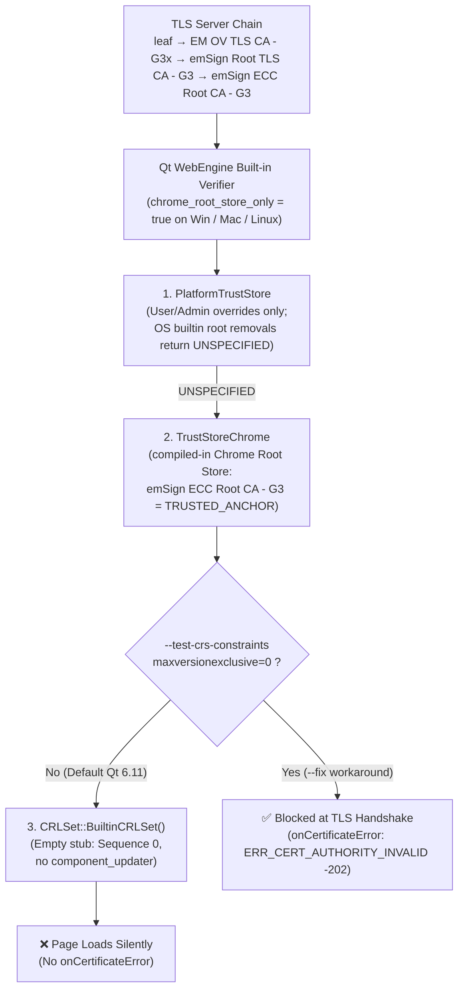

# QTBUG-58059: Qt WebEngine 6.x eMudhra G3 Certificate Distrust Reproducer & Workaround

Minimal CMake + Qt WebEngine Quick reproducer showing that **Qt WebEngine 6.11.0** (`Chromium 140.0.7339.225`) still trusts TLS certificates chaining to **`emSign ECC Root CA - G3`** (the root above the 8 compromised eMudhra G3 intermediate CAs disclosed in [October 2026](https://emudhra.we-have-a-problem.com/)), even on an OS with updated system certificates.

It also demonstrates a runtime workaround for existing Qt 6.x binaries without rebuilding Qt WebEngine, using Chromium's built-in `--test-crs-constraints` switch.

## How Certificate Verification Works in Qt WebEngine 6.11 (and Why OS Updates Don't Help)



## Quick Start (Clone, Build & Run in One Command)

```bash
git clone https://github.com/friofry/qtwebengine-emudhra-repro.git /tmp/qtwebengine-emudhra-repro && \
cd /tmp/qtwebengine-emudhra-repro && \
cmake -DCMAKE_PREFIX_PATH="$(qmake6 -query QT_INSTALL_PREFIX 2>/dev/null || qmake -query QT_INSTALL_PREFIX)" -B build -S . && \
cmake --build build && \
echo "--- WITHOUT FIX (vulnerable) ---" && \
./build/qtbug58059_repro && \
echo "--- WITH --fix (blocked) ---" && \
./build/qtbug58059_repro --fix
```

## Expected Output

### 1. Default Qt 6.11 behavior (vulnerable — page loads without certificate error)

```text
$ ./build/qtbug58059_repro
qml: RESULT=VULNERABLE_LOAD_SUCCEEDED certErrorSeen=false url=https://testovg3.emsign.com/RootOVG3.html
```

### 2. With Chrome Root Store constraint workaround (`--fix`)

Passes `--test-crs-constraints=86a1ecba089c4a8d3bbe2734c612ba341d813e043cf9e8a862cd5c57a36bbe6b:maxversionexclusive=0` via `QTWEBENGINE_CHROMIUM_FLAGS` before `QtWebEngineQuick::initialize()`:

```text
$ ./build/qtbug58059_repro --fix
qml: RESULT=BLOCKED_BY_CERT_ERROR type=-202 description="Server's certificate is not trusted" url=https://testovg3.emsign.com/
qml: RESULT=LOAD_FAILED certErrorSeen=true errorCode=-202 errorString=net::ERR_CERT_AUTHORITY_INVALID url=https://testovg3.emsign.com/
```

## Root Cause Details in `qtwebengine-chromium` (`140-based`)

1. **Compiled-in `CRLSet` is an empty stub when `component_updater` is disabled:**
   In `chromium/net/cert/crl_set.cc:376` (`CRLSet::BuiltinCRLSet()`), the built-in CRLSet is:
   ```text
   "\x31\x00{\"ContentType\":\"CRLSet\",\"Sequence\":0,\"Version\":0}"
   ```
   And the static SPKI blocklist update in `net/cert/cert_verify_proc_blocklist.inc` (plus the removal of `emSign ECC Root CA - G3` from `net/data/ssl/chrome_root_store/root_store.textproto`) has not yet been backported to `qtwebengine-chromium`.

2. **Updating OS system certificates does not remove trust in Qt WebEngine on desktop:**
   In `chromium/net/features.gni:57`, desktop builds use `chrome_root_store_only = is_win || is_mac || is_linux || is_chromeos`.
   `SystemTrustStoreChrome` combines `trust_store_system` and `trust_store_chrome_` via `bssl::TrustStoreCollection` (`trust_store_collection.cc:32`). Removing a root from the OS store only makes `trust_store_system` return `UNSPECIFIED`, so verification falls through to `trust_store_chrome_`, where `emSign ECC Root CA - G3` (`86a1ecba089c4a8d3bbe2734c612ba341d813e043cf9e8a862cd5c57a36bbe6b`) is compiled in as a `TRUSTED_ANCHOR`:
   - **Linux (`trust_store_nss.h:35`):** `TrustStoreNSS` explicitly ignores the builtin Mozilla roots slot (`IsMozillaCaPolicyProvided`). Updating distro `ca-certificates` / `nss 3.131.1` has no effect on Qt WebEngine.
   - **macOS (`trust_store_mac.cc:272, 438`):** `TrustStoreMac` only queries `kSecTrustSettingsDomainUser` and `kSecTrustSettingsDomainAdmin` (`kSecTrustSettingsDomainSystem` is `NOTREACHED()`).
   - **Windows (`trust_store_win.cc:443`, `win_util.cc:28`):** `TrustStoreWin` only reads registry stores (`CERT_STORE_PROV_SYSTEM_REGISTRY_W`) and does not support Microsoft's automatic disallowed CTL (`// TODO(crbug.com/40784681): support CTLs`).
